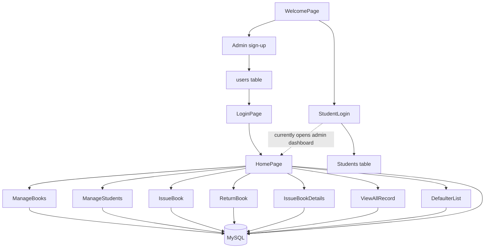
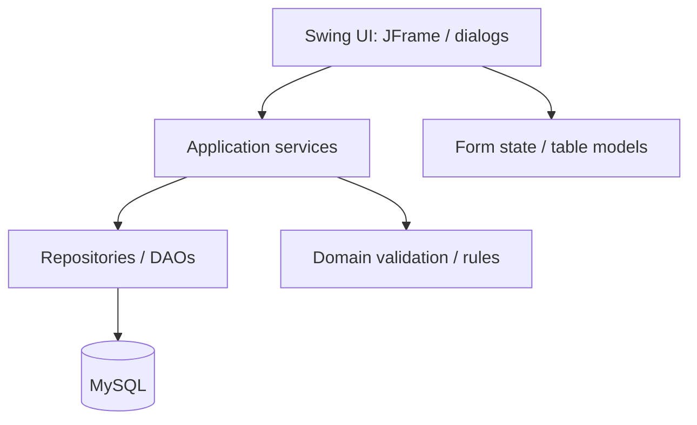

# Architecture and workflow notes

## 1. System shape

The application is a traditional desktop client. Swing `JFrame` classes render screens, call JDBC directly, and update their own widgets. MySQL stores catalogue, student, user, and circulation data. There is no dedicated repository/DAO layer or service layer yet.



The dashed student-login transition is a defect, not an intended permission model: a student login currently navigates to the same administrator dashboard as an administrator login.

## 2. Important classes

| Class | Responsibility observed in source |
|---|---|
| `jFrame.WelcomePage` | Entry screen with Admin and Student paths; configured application entry point |
| `jFrame.SignupPage` | Inserts account details into `users` |
| `jFrame.LoginPage` | Checks `users` credentials and opens `HomePage` |
| `jFrame.StudentLogin` | Checks `Students` credentials and also opens `HomePage` |
| `jFrame.HomePage` | Dashboard totals, most-issued-books chart, book/student summaries, navigation |
| `jFrame.ManageBooks` | Book CRUD on `book_details` |
| `jFrame.ManageStudents` | Student CRUD on `student_details` |
| `jFrame.IssueBook` | Looks up book/student records, inserts a loan row, decrements stock |
| `jFrame.ReturnBook` | Finds an active issue, marks it returned, increments stock |
| `jFrame.IssueBookDetails` | Lists active (`Pending...`) loans |
| `jFrame.ViewAllRecord` | Lists all issue records and supports issue-date range search |
| `jFrame.DefaulterList` | Lists pending loans whose due date is before the current date |
| `jFrame.DBConnection` | Creates JDBC connections from environment variables or JVM properties |

`library_management_system.Library_Management_System` contains an empty `main` method; the NetBeans project correctly points to `jFrame.WelcomePage` instead.

## 3. Current data flow

### Catalogue and student maintenance

`ManageBooks` and `ManageStudents` issue `SELECT`, `INSERT`, `UPDATE`, and `DELETE` statements from the form classes. The forms refresh their tables after successful writes. Selected table rows are copied back into their input fields for editing.

### Issue a book

1. The operator enters a book ID; the form reads `book_details` and displays the book name, author, and quantity.
2. The operator enters a student ID; the form reads `student_details` and displays the student's name, course, and branch.
3. The form checks for an existing `Pending...` record for the same book/student pair.
4. It inserts a row into `issue_book_details` with the issue date, due date, and `Pending...` status.
5. It separately decrements `book_details.quantity`.

Steps 4 and 5 currently use separate connections and are not one atomic transaction. A failure between them can make the loan ledger disagree with available stock. The current form also lacks robust validation for blank IDs, malformed IDs, missing dates, and due dates earlier than issue dates.

### Return a book

1. The operator enters book and student IDs.
2. The form looks up a pending loan for that pair.
3. The form changes the matching row's status to `Returned!`.
4. It separately increments the book quantity.

The status update and stock increment are not transactional. The safer target is to select the exact issue row by its primary key and perform status update plus stock increment in one transaction.

### Reports and dashboard

- `IssueBookDetails` reads pending loans only.
- `ViewAllRecord` reads all loans and filters by `issue_date` using an inclusive `BETWEEN` range.
- `DefaulterList` reads pending loans with `due_date < current date`; items due today are not yet classified as overdue.
- The dashboard pie chart counts issue-history rows grouped by book name. The four dashboard cards count book records, student records, pending issue rows, and overdue pending rows.

## 4. Target architecture

The recommended direction is a small layered architecture that can be introduced incrementally without replacing Swing:



Suggested package split:

```text
src/
├── jFrame/                 # Existing presentation layer; keep generated form code here
├── model/                  # Book, Student, User, Loan domain objects
├── repository/             # BookRepository, StudentRepository, LoanRepository, UserRepository
├── service/                # AuthenticationService, CirculationService, ReportingService
├── validation/             # Input and business-rule validators
└── config/                 # Database configuration and connection factory
```

Keep NetBeans-generated `initComponents()` blocks focused on layout. Move SQL, transactions, and domain rules into services/repositories so they can be tested without opening a window.

## 5. Architectural constraints to preserve during refactoring

- Keep issue-history rows as historical records; do not erase a loan when a book is returned.
- Keep a stable loan ID and use it for return operations.
- Keep prepared statements for every query that contains user-provided values.
- Use database foreign keys from issue rows to book and student records.
- Treat book `quantity` as physical copies available, not as a count of distinct titles.
- Avoid renaming tables/columns until a migration is written and the current database schema has been inspected.
